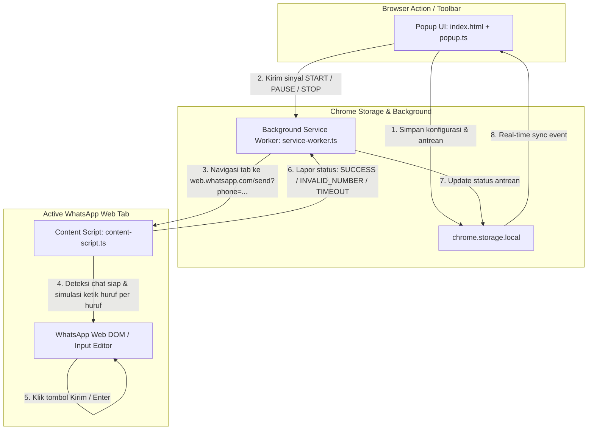

# Design Specification: WhatsApp Web Typing & Auto-Sender Chrome Extension

- **Date**: 2026-10-20
- **Status**: Draft (Under Review)
- **Author**: Antigravity & User

---

## 1. Ringkasan & Tujuan Proyek

Ekstensi Chrome ini dirancang untuk membantu pengguna mengirimkan pesan WhatsApp secara massal (broadcast/bulk sender) langsung melalui antarmuka **WhatsApp Web** (`web.whatsapp.com`) dengan mekanisme **simulasi pengetikan alami (human-like typing)** karakter demi karakter.

Tujuan utama:
1. **Otomatisasi Pengetikan & Pengiriman**: Membuka obrolan tujuan dan mengetikkan pesan secara otomatis ke kolom chat WhatsApp Web dengan efek ketikan manusia nyata.
2. **Personalisasi Pesan Dinamis**: Mendukung penggantian variabel seperti `{nama}` untuk masing-masing penerima.
3. **Keamanan Akun (Anti-Spam Mitigation)**: Menerapkan jeda waktu acak (random delay) antar pengiriman pesan dan jeda ketik acak antar karakter guna meminimalkan risiko pembatasan akun WhatsApp.
4. **Antarmuka Pengguna Modern & Intuitif**: UI Popup toolbar berbasis Tailwind CSS dengan pemantauan progres real-time, tombol Jeda/Lanjut/Hentikan, dan penanganan nomor tidak valid secara otomatis.

---

## 2. Arsitektur Teknis

Ekstensi mengadopsi standar **Chrome Extension Manifest V3** dengan bundler modern **Vite** dan bahasa **TypeScript**:

- **Runtime Target**: Google Chrome / Chromium-based browsers (Manifest V3).
- **Tooling & Bundler**: Vite + `@crxjs/vite-plugin` (atau Vite multi-input build configuration).
- **Styling**: Tailwind CSS (ringan, modern, utility-first).
- **Testing**: Vitest untuk pengujian unit logika (normalisasi nomor, parser template, queue reducer).

### Diagram Alur Data & Komunikasi

---

## 3. Rincian Modul & Komponen

### 3.1. Popup Toolbar UI (`src/popup/`)
- **Indikator Koneksi**: Memeriksa ketersediaan tab `web.whatsapp.com` dan memberikan tombol cepat untuk membukanya jika belum ada.
- **Input Kontak**:
  - Kolom teks multilinea / file upload CSV/TXT.
  - Mendukung format: `nomor, nama` atau hanya `nomor`.
  - Normalisasi otomatis: format `08123...` atau `+62 812...` dikonversi ke format standar WhatsApp `62812...`.
- **Editor Template & Live Preview**:
  - Input template teks dengan tombol pintas memasukkan `{nama}`.
  - Kotak pratinjau real-time memperlihatkan hasil teks untuk baris kontak pertama.
- **Pengaturan Waktu & Keamanan**:
  - Rentang jeda antar kontak (default: 5 s.d. 10 detik acak).
  - Kecepatan ketik per karakter (default: 50ms s.d. 120ms acak).
- **Kontrol & Status Progres**:
  - Tombol aksi: `Mulai Kirim`, `Jeda`, `Lanjutkan`, `Hentikan`.
  - Progress bar dinamis (persentase selesai).
  - Penghitung: Total Target, Sukses (hijau), Gagal/Invalid (merah), Sisa antrean.
  - Tabel log aktivitas singkat dengan timestamp dan nomor telepon.

### 3.2. Background Service Worker (`src/background/service-worker.ts`)
- Berperan sebagai **pengatur antrean sentral (Queue Orchestrator)**.
- Menjaga state antrean di `chrome.storage.local` agar pengiriman tetap berlanjut meskipun jendela popup ditutup oleh pengguna.
- Mengidentifikasi tab WhatsApp Web:
  - Jika tab WhatsApp Web belum ada, service worker dapat membuka tab baru atau meminta pengguna membukanya.
  - Mengarahkan tab aktif ke `https://web.whatsapp.com/send?phone=<cleanNumber>`.
- Menerima pesan hasil dari Content Script, mengelola hitung mundur jeda aman antar nomor, dan memicu kontak berikutnya.

### 3.3. Content Script (`src/content/content-script.ts`)
- Menginjeksi langsung ke halaman `https://web.whatsapp.com/*`.
- **Deteksi Kesiapan Chat**:
  - Menggunakan polling & `MutationObserver` untuk mendeteksi elemen input chat (`div[contenteditable="true"][role="textbox"]`).
  - Timeout maksimal 25 detik untuk menghindari macet jika internet melambat.
- **Deteksi Nomor Tidak Valid**:
  - Mendeteksi dialog peringatan WhatsApp Web: modal popup dengan tombol "OK" (*"Nomor telepon yang dibagikan melalui tautan tidak valid"*).
  - Jika dialog muncul, content script otomatis menekan tombol OK, mengirim laporan `STATUS: INVALID_NUMBER` ke Service Worker, dan menyelesaikan tugas untuk nomor tersebut.
- **Simulasi Pengetikan Alami (Human-like Typing)**:
  - Mengaktifkan fokus pada elemen chat editor.
  - Mengetikkan teks karakter demi karakter dengan `document.execCommand('insertText', false, char)` atau `InputEvent` sintetis, diselingi jeda acak 50–120ms.
  - Memastikan event reaktif WhatsApp terpicu sehingga tombol kirim (ikon pesawat kertas) aktif.
- **Pengiriman Pesan**:
  - Menunggu 500ms setelah pengetikan selesai.
  - Mencari dan mengklik tombol kirim (`button span[data-icon="send"]`).
  - Fallback ke `KeyboardEvent('keydown', { key: 'Enter', code: 'Enter', keyCode: 13, bubbles: true })`.
  - Mengonfirmasi pesan terkirim dan melaporkan `STATUS: SUCCESS`.

### 3.4. Shared Utility Modules (`src/shared/`)
- `types.ts`: Definisi antarmuka `ContactItem`, `QueueState`, `SenderSettings`, `LogEntry`, dan tipe pesan IPC antar script.
- `normalizer.ts`: Logika pembersihan dan konversi nomor telepon ke format E.164 / standar WhatsApp tanpa simbol non-angka.
- `template.ts`: Parser pengganti variabel `{nama}` dengan nilai aktual atau fallback aman jika nama kosong.
- `sleeper.ts`: Helper async promise delay dengan variasi acak (jitter) `randomBetween(min, max)`.

---

## 4. Penanganan Kasus Khusus (Edge Cases & Error Handling)

| Skenario | Penanganan Sistem |
| :--- | :--- |
| **Popup ditutup saat proses berjalan** | State antrean disimpan di `chrome.storage.local`; Background Service Worker tetap memproses antrean dan Content Script tetap berjalan tanpa interupsi. |
| **Nomor tidak terdaftar di WA** | Script mendeteksi modal popup error dialog WA, mengklik tombol konfirmasi/OK, menandai kontak sebagai `GAGAL`, dan langsung beralih ke nomor berikutnya. |
| **Halaman WA Web crash / tidak merespons** | Timeout pelindung 25 detik per nomor mencegah antrean berhenti permanen; status dicatat sebagai `TIMEOUT`. |
| **Nomor memiliki format beragam (0812..., +62 812..., 62-812...)** | Normalizer regex membersihkan seluruh spasi, tanda kurung, dan tanda strip, lalu mengubah awalan `0` menjadi `62`. |
| **Pengguna ingin membatalkan/menjeda proses** | Tombol `Jeda` dan `Hentikan` langsung memperbarui state di storage, menghentikan loop antrean seketika. |

---

## 5. Rencana Pengujian (Testing Strategy)

1. **Unit Testing (Vitest)**:
   - Tes normalisasi nomor telepon berbagai format (awalan `08`, `+62`, `62`, karakter khusus).
   - Tes templating: penggantian tag `{nama}` dan penanganan string kosong.
   - Tes antrean (queue reducer logic): transisi status dari pending ke sent/failed.
2. **Integration & Build Testing**:
   - Memastikan `npm run build` menghasilkan bundle ekstensi yang valid di folder `dist/` dengan `manifest.json` yang mematuhi spesifikasi MV3.
3. **Manual Browser Verification**:
   - Muat ekstensi via `chrome://extensions` (Mode Pengembang $\rightarrow$ Muat yang belum dibongkar / Load Unpacked).
   - Buka WhatsApp Web yang sudah login.
   - Uji pengiriman 2–3 nomor uji coba untuk memverifikasi efek ketikan huruf per huruf dan jeda waktu acak.

---

## 6. Pertimbangan Keamanan & Privasi

- **Tidak Ada Server Eksternal / Pelacakan**: Seluruh pemrosesan kontak dan pesan dilakukan 100% lokal di browser pengguna.
- **Pemberitahuan Penggunaan Aman**: Disertakan rekomendasi jeda waktu minimal pada UI untuk mencegah risiko pembatasan oleh sistem spam WhatsApp.

